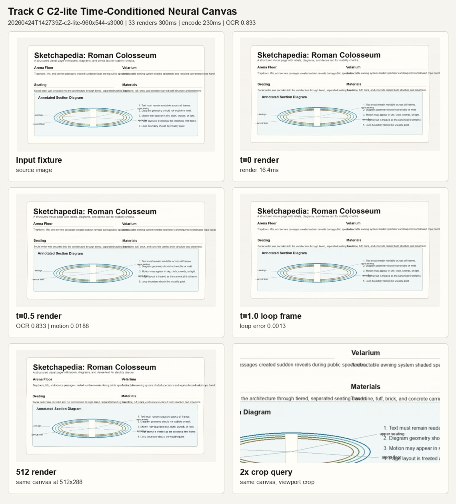

# Flipbook Research

Research on rendering interactive visual pages in real time from a learned neural canvas, instead of repainting every frame through a video model. The work was inspired by Flipbook-style model-rendered interfaces ([the tweet that started it](https://x.com/zan2434/status/2046982383430496444?s=20)).

## Result so far

**Status: measured research prototype. A small per-page neural renderer renders faster than realtime, but text stays legible only under mild motion.**

Track C is the most promising path. It combines a stable learned canvas, a layout transform, and a small neural renderer. The prototype trains a tiny per-page renderer on one text-heavy page, then stress-tests resizing, cropping, and motion at 1280x736. OCR score is token F1 against the source page (higher is better).

| Motion test | Moderate | Strong |
| --- | --- | --- |
| Dense learned frame-scale motion | 0.1053 | 0.0000 |
| Stable canvas + layout transform | 0.7091 | 0.3610 |
| Stable canvas + OCR line anchors | 0.7321 | 0.4124 |

- Rendering 33 frames at 960x544 took about 302-442 ms. At 24 fps, 33 frames is 1.375 s of video, so rendering is faster than realtime. The 33-frame render times are in `docs/benchmarks/track-c-c0-neural-canvas-2026-04-24.md`.
- The scores come from `docs/experiments/track-c/evaluate-c71.log`.
- Text under strong motion is still poor, and the renderer is trained per page rather than general. Of about 900 logged Track C runs, 417 pass and 481 are near misses (`docs/experiments/track-c/results.tsv`). Recent runs on generated holdout pages (C124 in `docs/experiments/track-c/`) are mostly near misses.



Demo videos from the model, rendered at about 2.5x realtime:

- https://github.com/user-attachments/assets/6fcdb84c-d5e7-40e3-b885-a03fd29fcea6
- https://github.com/user-attachments/assets/328edda6-f908-4b04-9333-1b11749a1f04

## Run it

The main experiment entrypoint is a Modal script. It needs a Modal account and GPU access.

```bash
modal run scripts/track_c/modal_canvas_c2_lite.py --help
```

Long runs should be launched through `tmux`. `scripts/track_c/README.md` has the exact commands for each experiment.

## Approach

```text
stable learned canvas
+ layout/query transform
+ small neural renderer
= realtime model-rendered pixels
```

The research is split into tracks. Track A benchmarks a full-frame LTX video model, Track B tests a static image plus motion, Track C is the neural canvas above, Track D aims at a general model that is not trained per page, and Track V benchmarks hosted video models. The first performance target for any track is 33 frames generated, decoded, and encoded in 1.3 s or less.

## Repository map

- `docs/` - research notes, see `docs/README.md` for an index.
  - `architecture/` - observed Flipbook architecture notes.
  - `poc/` - proof-of-concept tracks and the benchmark target.
  - `research/` - model, text, and neural-canvas research notes.
  - `planning/` - research plans and parallel workstreams.
  - `evaluation/` - neural-canvas scorecards and eval schemas.
  - `benchmarks/` - summarized benchmark results.
  - `experiments/` - experiment logs and TSV result tables.
- `scripts/track_a/` - LTX/video-model benchmark helpers.
- `scripts/track_c/` - neural-canvas Modal experiments.
- `scripts/track_d/`, `scripts/track_v/` - fixture generation and hosted-video benchmarks.
- `fixtures/` - small reproducible input fixtures.
- `outputs/` - lightweight showcase images only; large generated run dumps are ignored.
